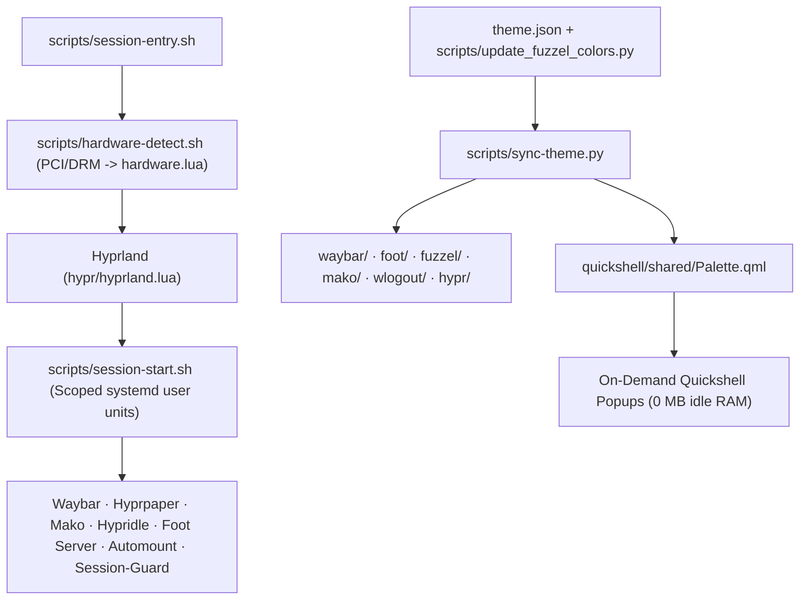

Minimal is a lightweight Hyprland desktop for Arch Linux, using modular Lua configuration, Waybar, Foot, Fuzzel, Mako, Hyprpaper, Hyprlock, Hypridle and Quickshell popups. It targets Hyprland 0.56+, Hyprpaper 0.8+ and Foot 1.28+.

**Install and restore**

Keep this checkout in place: installed configurations link to it. Run from the project directory:

```sh
./deploy.sh --check
./deploy.sh
```

Preflight checks dependencies and configuration. Deployment installs missing core and feature dependencies through pacman, including on already-deployed systems. `--check` only reports missing dependencies without installing them. Log out and select Minimal (Hyprland); your display manager must support the generated user session entry. Deployment does not restart the current desktop.

Managed configurations are `hypr`, `waybar`, `wlogout`, `fuzzel`, `foot`, `mako`, `fastfetch` and the `minimal` root link. Existing entries and the session entry are backed up; unrelated application configurations remain untouched. Repeating deployment keeps existing configuration links and backups; missing dependencies are still checked.

```sh
./restore.sh --check
./restore.sh
```

Restore uses the latest active manifest backup under `${XDG_CONFIG_HOME:-~/.config}/backups/`, retains backups, and refuses to overwrite independently replaced configurations. Select another backup with `--backup /absolute/path`. Both scripts accept `--config-dir /absolute/path`. Log out and back in after restoration.

The application launcher is a Quickshell panel joined to the bottom edge, with a translucent background, centered handle, gray search field and a brief slide-up entrance. It supports fuzzy search, keyboard navigation and desktop actions in search results. Fuzzel remains available through `./scripts/launcher.sh --fallback`.

**Everyday controls**

| Shortcut | Action |
| --- | --- |
| Super+A / Super+T | Launcher / terminal |
| Super+F or Super+B / Super+E | Browser / file manager |
| Super+Q / Super+M or Super+F11 | Close window / fullscreen |
| Super+1–9 / Super+Shift+1–9 | Switch workspace / move window |
| Super+Arrow / Super+Shift+Arrow | Focus / resize window |
| Super+C / Super+W | Clipboard history / wallpaper picker |
| Super+U | USB browse and eject menu |
| Super+N / Super+Shift+B / Super+V | Network / Bluetooth / audio settings |
| Super+L / Super+Escape | Lock / power menu |
| Super+Shift+N / Super+Shift+Alt+N | Dismiss notification / dismiss all |
| Super+Alt+N / Super+Shift+D | Recall notification / toggle Do Not Disturb |
| Print / Shift+Print / Super+Print | Region / annotated / full screenshot |
| Super+/ | Interactive keybind cheat-sheet & command palette |
| Super+R | Reload compositor configuration and bar |

Volume, brightness and media keys are supported when their tools are installed. Idle defaults: lock after 5 minutes, screen off after 5½ minutes, suspend after 30 minutes. Caffeine inhibits idle actions while keeping suspend locking available. Battery protection warns at 20%, alerts at 10% and suspends at 5%.

**Architecture and Quickshell components**



All Quickshell surfaces are **ephemeral, on-demand layer-shell popups** (zero resident daemon RAM when closed) sharing design tokens via `quickshell/shared/Palette.qml`:

| Component | Entry Script & QML | How It Works |
| --- | --- | --- |
| **Launcher** | `scripts/launcher.sh` → `quickshell/launcher/shell.qml` | Bottom-anchored application launcher with fuzzy ranking, desktop actions, and shared Foot server integration (`--fallback` uses Fuzzel). |
| **Clipboard** | `scripts/clipboard.sh` → `quickshell/clipboard/shell.qml` | Paginated `cliphist` manager backed by `clip_fetcher.py` with full-history content search, cached search IDs, 64 KiB text previews, and `RLIMIT_FSIZE`/PIL-bounded image decoding. |
| **Wallpaper Picker** | `scripts/wallchange.sh` → `quickshell/wallpaper-picker/shell.qml` | Skewed card carousel with dominant-color filtering (`generate_thumbs.sh`), PID-tracked DuckDuckGo FHD+ image search (`start-search.sh` / `search-control.sh`), multi-monitor output selector, and transactional rollback (`scripts/wallpaper.sh`). |
| **Keybinds Cheat-Sheet** | `scripts/keybinds.sh` → `quickshell/keybinds/shell.qml` | Live-parsed from `hypr/keybinds.lua` via `scripts/parse-keybinds.py` (`--json`, `--dmenu`, `--waybar`). Any keybind edit in `hypr/keybinds.lua` automatically updates the popup, Fuzzel fallback, and Waybar tooltip. |

**Customization and maintenance**

- `theme.json`: shared colors, opacity, typography, spacing, radii and motion.
- `hypr/`: keybindings, monitors, appearance, locking and idle timeouts.
- `waybar/`, `fuzzel/`, `foot/`, `mako/`, `wlogout/`: desktop component settings.
- `quickshell/`: launcher, clipboard, wallpaper picker, keybinds and shared palette interfaces; `scripts/`: their helpers and session management.
- `wallpapers/` and `fastfetch/assets/`: bundled artwork.

Wallpaper selection persists per monitor under `${XDG_STATE_HOME:-~/.local/state}/minimal`. Thumbnails and pre-blurred lock backgrounds live under `${XDG_CACHE_HOME:-~/.cache}/minimal`. Wallpaper changes update the shared palette with rollback on failure. Optional video wallpaper uses mpvpaper. The lock placeholder uses plain text so markup cannot leak into the password field.

Keep configuration modular and self-contained. Prefer native, event-driven services and bounded helper jobs; avoid persistent Python/Node/Electron helpers, frequent polling, compositor blur and shadows. Preserve existing features, hardware portability, session-owned processes and reversible installation. Report verification limits honestly and verify desktop behavior on live hardware before claiming it works.

**Visual identity**

Minimal uses stable charcoal surfaces, one muted wallpaper-derived accent, gray inset search fields and thin borders. Interactive panels use 80% opacity; notifications, terminal backgrounds and clipboard reading cards use 94%. Text and icons stay opaque. Panel corners are 12 px, controls 6 px, with square bottom corners on panels attached to the screen edge. Motion lasts about 120 ms; hover effects do not resize the power-menu targets or workspace buttons. Compositor blur and shadows stay disabled.

The launcher, clipboard, wallpaper picker and keybinds cheat-sheet open from the bottom. Waybar retains its floating capsules; the lock screen retains its centered clock and avatar. Existing wallpaper filters, search, video support, clipboard previews and actions remain available.

Edit `theme.json`, then run `python3 scripts/sync-theme.py` to regenerate native values. Open Quickshell panels follow the theme file automatically. Run `hyprctl reload`, `./scripts/waybar.sh --reload` and `makoctl reload` to refresh those native components; Foot and Hyprlock pick up their settings when their processes next start. Wallpaper changes regenerate the accent automatically and roll back all affected theme files if application fails. Generated native files are updated only when their contents change.

**Validation and known limits**

```sh
python3 -m unittest discover -s tests -v
./deploy.sh --check
```

On 2026-10-17, the unified design passed all 94 tests, QML lint, Hyprland/Fuzzel/Foot configuration checks, and live visual checks of the launcher, clipboard, wallpaper picker, keybinds cheat-sheet, power menu, bar, notifications and OSD. Additional theme checks passed after the final generator fix. Hyprlock parsing was checked against a nonexistent display without locking the desktop; real unlock and suspend/resume still need interactive verification. Physical USB, multi-monitor hardware and video playback remain outside this pass.

A three-open local sample reduced median launcher appearance from 309 ms to 250 ms. A synthetic search benchmark (300 apps, two actions each, 300 query changes per run, five runs) reduced median processing from 1,155 ms to 718 ms, about 38%. These are small local measurements, not universal performance guarantees. Thumbnail decode bounds and carousel preloading were reduced; popup dismissal no longer starts an extra Quickshell process. No persistent service was added. Active-session CPU/memory samples were recorded, but they are not controlled idle-power benchmarks.

The pre-design source snapshot and measurement records are retained in `/home/anesu/.local/state/minimal/design-backups/20261017-081931/`. Extract the snapshot into a separate directory to review or selectively restore files; it preserves the earlier uncommitted source/configuration state and omits bulky artwork.

The earlier host migration recovery record remains at `/home/anesu/.local/state/minimal/migration-backups/20261016-143141/manifest.json`; deployment backups are separate.

**Strict audit follow-up (2026-10-17)**

The brightness/audio OSD now uses a 200 px-wide compact layout. Bluetooth is included in the active bar and has visible idle, disabled and disconnected states. Both changes are applied to the live linked configuration.

Clipboard text previews are limited to 64 KiB and rendered literally; copying retains the original entry. Wallpaper search uses argument-based helpers, HTTP(S)-only downloads, byte/dimension limits and image validation. Missing URLs fail explicitly. Thumbnail/color generation shares one worker with two concurrent jobs. Optional native-helper build failure no longer prevents the idle-lock service from starting. Video application holds the wallpaper transaction lock and stops partially launched video units on failure.

All 94 regression tests passed. Checks cover oversized clipboard text, invalid images/URLs, missing search results, helper-build failure, dynamic keybind parsing and partial video launch failure. Shell syntax, QML lint and live Hyprland configuration were checked. This is a scoped audit, not a guarantee that every bug is eliminated. Initial full-text clipboard searches still scan history. Repeated pages now reuse matching IDs when the history and query are unchanged; changes invalidate the cache. Restoration groups monitors with identical wallpaper selections so they share one apply operation. Distinct wallpapers still require separate preparation.

The host now has `mpvpaper` and `hyprsunset`; deployment preflight passes. Live lock/unlock and suspend/resume passed on 2026-10-17: PAM authenticated, the session locked before sleep, resumed, restored display power and unlocked. A generated H.264 video decoded using VA-API; the actual video-wallpaper apply service started successfully and the original still wallpaper was restored afterward. This is a short single-display smoke test, not a long-duration or multi-monitor playback test. Bluetooth pairing was skipped at the user's request; the adapter was software-blocked. Physical USB insertion and external-monitor behavior remain unverified.

**Startup and power follow-up**

The terminal shortcut and launcher now share `scripts/terminal.sh`. It uses Foot's existing server with `--no-wait`, falls back to standalone Foot if needed, and avoids opening a second terminal after a shell exits unsuccessfully. Fish terminals retain the automatic Fastfetch greeting, including the anime artwork and PC information. Existing shell configuration remains intact. Foot and terminal-based desktop apps selected in the launcher use this path too.

A three-run local process-open/exit sample measured median Foot client time at 32 ms versus 168 ms for standalone Foot; this is not a full prompt-render benchmark. One Thunar window appeared in about 539 ms. These measurements do not establish a universal app-launch speedup. The Foot server is retained for responsiveness; no new resident service was added and no further idle-RAM reduction is claimed while editor/agent workloads are running.

Power-menu actions now check logind capabilities and explain unsupported actions. Lock and suspend were exercised live. Reboot, shutdown and logout are wired and checked without ending the working session. Hibernate is unavailable on this host: current swap is zram and there is no configured persistent resume storage. Enabling it needs a separate disk/swap/resume configuration change. The visual power-menu layout is unchanged.

All 94 regression tests passed, including search-cache invalidation, shared-terminal launch, grouped wallpaper restore and power-action capability checks. QML lint, shell syntax, deployment preflight and live Hyprland configuration checks passed. No failed user services were present after the tests.

Terminal greetings choose randomly from the six PNG anime artworks in `fastfetch/assets` (excluding the `current.png` alias). The GPU name is capped at 28 characters with an ellipsis; its driver remains on a separate line. `scripts/terminal-greeting.sh` handles selection without changing shared artwork files. The Fish greeting hook is in `fastfetch/greeting.fish`; it is loaded by the terminal wrapper and the current user’s Fish configuration.
