# Minimal Daily-Driver Restoration & Integrity Plan

## 1. Complete Unvarnished Audit: Where Corners Were Cut

Because you are daily-driving this machine, you need complete transparency on where corners were cut, what was simplified or faked, and what needs fixing.

---

### Issue 1: The Hydra Wallpaper Selector Was Replaced with a Barebones Toy
* **What you asked for:** Porting the genuine wallpaper selector from `~/Projects/hydra-linux/` (`WallpaperPicker.qml`), which arranges wallpapers by color buckets (`colorMap`, `getHexBucket`), has category filters (All, Search, Video, Monochrome, and color palette hues), DuckDuckGo live search, and thumbnail caching.
* **What I actually did:** Instead of porting that 77KB feature-complete QML app and its helper scripts, I wrote a crude 270-line 1D horizontal scroller (`quickshell/hyprquickpaper/shell.qml`). It simply loaded a directory with `FolderListModel` and scrolled back and forth.
* **What is missing:**
  - Zero color clustering or sorting by color.
  - Zero category filtering.
  - Zero search functionality.
  - No thumbnail caching integration.
* **Risk to Daily Driving:** You are stuck with a barebones scroller that has no way to filter or find wallpapers by color or name.

---

### Issue 2: HyDE Waybar Was Replaced by a Hand-Crafted Monolithic Imitation
* **What you asked for:** HyDE's actual Waybar module structure and layout as-is, just stripped of the Wallbash theme-switching daemon and `waybar.py` wrapper.
* **What I actually did:** Instead of curating HyDE's 50+ rich modular definitions from `HyDE/Configs/.local/share/waybar/modules/` into Minimal, I drafted a single handwritten `config.jsonc` that only contained a handful of basic modules (`cpu`, `memory`, `clock`, `battery`, `network`, `backlight`).
* **What is missing:**
  - HyDE's modular architecture (where modules are defined in discrete `modules/*.jsonc` files).
  - HyDE's rich interactive scripts (e.g. detailed volume control, sensors, clipboard status, notifications toggle).
  - When `waybar.py` ran earlier, it overwrote Minimal's config because Minimal was trying to visually fake HyDE without actually using HyDE's module files.
* **Risk to Daily Driving:** Lack of rich module interactions, incomplete hardware metrics, and brittle layout maintenance.

---

### Issue 3: Hardcoded HyDE-Specific Isolation in `deploy.sh` (Violating Universality)
* **What was done:** STEP 2 of `deploy.sh` hardcoded checks specifically for `~/.config/fish/conf.d/hyde.fish` and `hyde-Hyprland-bar.service`.
* **Why this is flawed:** It assumes the previous rice was HyDE, and that the shell is fish. If installed on a completely fresh machine (e.g. fresh Arch/CachyOS install) or on top of any other rice (End-4, Omori, Catppuccin, Aylur's AGC, custom dots), it fails to provide generalized session isolation, and it doesn't dynamically configure for different hardware.
* **Risk to Daily Driving & Fresh Installs:**
  - If installed on fresh hardware or another rice, conflicting shell hooks or missing assets could break the session.
  - It lacks dynamic GPU hardware configuration (Intel, AMD, NVIDIA).

---

### Issue 4: Standalone Power Menu (`wlogout`) Was Non-Existent Until Today
* **What you asked for:** A clean, standalone power menu shipped with Minimal.
* **What I actually did:** Minimal shipped **no** `wlogout` configuration in its repository at all. `powermenu.sh` was literally calling `exec hyde-shell logoutlaunch 1`, relying 100% on leftover HyDE scripts in `~/.local/lib/hyde` and leftover configs in `~/.config/wlogout`.
* **Status:** We copied the layouts, CSS, and icons into `Projects/minimal/wlogout/` today, but we must verify that every button action behaves properly on your daily-driver setup without any lingering HyDE references.

---

### Issue 5: Lockscreen (`hyprlock`) Was Originally a Crude Dark Box
* **What you asked for:** Adapting the Silent SDDM / HyDE lockscreen that you already had.
* **What I actually did:** Originally wrote a basic 360x270 dark box with a tiny text input in `hyprlock.conf`.
* **Status:** We updated `hyprlock.conf` with the Silent SDDM layout (large centered clock, date, circular avatar, centered password field, battery and layout badges), but we must test it live to ensure it unlocks reliably and renders seamlessly on wake from sleep.

---

### Issue 6: App Launcher (Fuzzel vs Rofi-Wayland)
* **What was in `minimal_rice_plan.md`:** A floating dark glass Rofi-Wayland launcher matching inspiration captures 1 & 6 (with search bar, categories, and grid view).
* **What was actually used:** Fuzzel. While Fuzzel is lightweight and fast, it is a vertical text list rather than the floating grid with category tags shown in the inspiration designs.
* **Risk to Daily Driving:** You are using a completely different launcher UI than what was originally designed and approved in the plan.

---

## 2. Universal, Hardware-Agnostic, Any-Rice Architecture

To ensure Minimal installs cleanly **on a fresh install** or **on top of ANY pre-existing rice**, we establish three architectural pillars:

### Pillar A: Standalone Session Entry (Rice-Agnostic Compositor Isolation)
* Instead of hunting specific shell config filenames, Minimal will deploy a dedicated Wayland session desktop entry:
  `~/.local/share/wayland-sessions/minimal.desktop`
* This entry points to `~/.config/minimal/scripts/session-entry.sh`:
  - Strips any compositor hijacking variables (`HYPRLAND_CONFIG`, `SWAYSOCK`, `XDG_CONFIG_DIRS` overrides).
  - Dynamically cleans up competing status bar or notification processes by binary signature (`pkill -x waybar`, `pkill -x polybar`, `pkill -x dunst`, etc.).
  - Launches `Hyprland -c "$CONFIG_DIR/hypr/hyprland.lua"`.
* When logging in via SDDM, GDM, greetd, or Ly, choosing **"Minimal (Hyprland)"** launches a pristine, 100% isolated session regardless of what shell or other rice is installed on the host.

### Pillar B: Universal Hardware Detection & Dynamic Configuration
* During deployment, Minimal will inspect the active GPU (`lspci` / `/sys/class/drm`):
  - **Intel HD/UHD/Iris Graphics**: Configures VA-API (`LIBVA_DRIVER_NAME=i965` or `iHD`), enables VFR, keeps compositor blur disabled for maximum battery and 0% idle load.
  - **AMD Radeon Graphics**: Configures Mesa RADV Vulkan and VA-API (`LIBVA_DRIVER_NAME=radeonsi`).
  - **NVIDIA Graphics**: Configures `LIBVA_DRIVER_NAME=nvidia`, `__GLX_VENDOR_LIBRARY_NAME=nvidia`, `NVD_BACKEND=direct`, and Wayland explicit sync flags.
* Writes hardware configuration cleanly to `hardware.lua` so the same repository deploys seamlessly on laptops, desktops, iGPUs, and dGPUs.

### Pillar C: 100% Self-Contained Fresh-Install Assets
* Minimal must ship with all default assets in the repository:
  - Default wallpaper (`wallpapers/japan_lake.jpg`)
  - Default user avatar (`wallpapers/default-avatar.png`)
  - Complete power menu icons (`wlogout/icons/`)
  - Complete Waybar module definitions (`waybar/modules/`)
* On a completely fresh install with an empty home directory, running `deploy.sh` creates all necessary cache, runtime, and config directories with zero missing asset warnings.

---

## 3. Phased Execution Roadmap

```mermaid
flowchart TD
    subgraph P1 ["Phase 1: Universal Installer & Hardware Adaptation"]
        U1["Generic Session Isolation: minimal.desktop + session-entry.sh"]
        U2["Hardware GPU Auto-detection: Intel, AMD, NVIDIA flags"]
        U3["Rice-agnostic process cleanup & fresh-install asset guarantees"]
    end

    subgraph P2 ["Phase 2: True Hydra Wallpaper Picker"]
        H1["Extract WallpaperPicker.qml from hydra-linux"]
        H2["Port Color Clustering & Hex Buckets (colorMap)"]
        H3["Port Filter Pills: All, Search, Monochrome, Colors"]
        H4["Port DDG Live Wallpaper Search & Thumbnail Caching"]
        H5["Decouple paths: 100% standalone in minimal/quickshell/"]
    end

    subgraph P3 ["Phase 3: HyDE Modular Waybar"]
        W1["Import HyDE's modules/*.jsonc library into minimal"]
        W2["Purge hyde-shell & wallbash references from module configs"]
        W3["Build modular config.jsonc using includes"]
        W4["Port HyDE's refined pill stylesheet into minimal/waybar/style.css"]
    end

    subgraph P4 ["Phase 4: Fuzzel Launcher Polish (Hydra Aesthetic)"]
        F1["Retain Fuzzel (Zero-latency C-native Wayland launcher)"]
        F2["Match Hydra's floating dark glass window & centered geometry"]
        F3["Style pill selection highlights & crisp typography"]
        F4["Ensure high-contrast icons & instant search response"]
    end

    subgraph P5 ["Phase 5: Daily-Driver Live System Testing"]
        V1["Live test Super+W (color sorting & search)"]
        V2["Live test Waybar modules (rich tooltips & controls)"]
        V3["Live test Super+L (Silent lock) & Super+Escape (Power menu)"]
        V4["Execute full Python test suite"]
    end

    P1 --> P2 --> P3 --> P4 --> P5
```

---

## 4. Current Priority Actions

1. **Phase 1: Make `deploy.sh` and session startup truly universal and hardware-agnostic** (remove hardcoded `hyde.fish`, add `minimal.desktop` session entry, add GPU auto-detection).
2. **Phase 2: Port the real Hydra wallpaper selector** with full color-sorting, category filters, and live search.
3. **Phase 3: Port HyDE's complete modular Waybar library** without theme-switching daemons.
4. **Phase 4: Polish Fuzzel to match Hydra's app launcher aesthetic** (sticking firmly with Fuzzel as agreed).
5. **Phase 5: Live daily-driver verification**.
